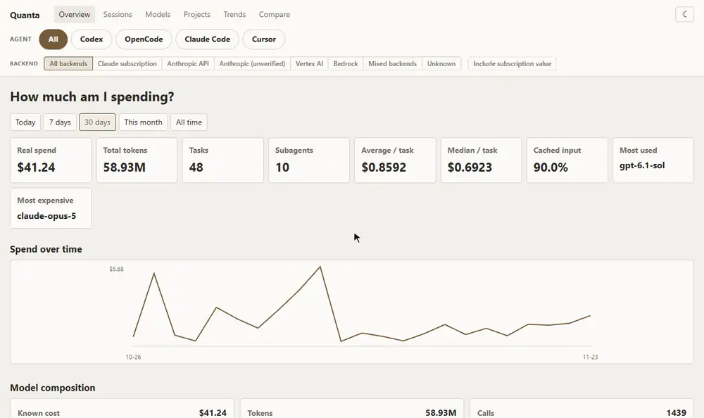
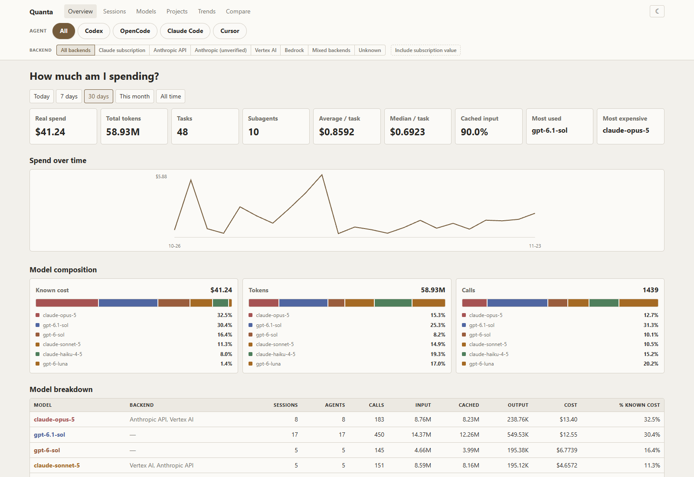
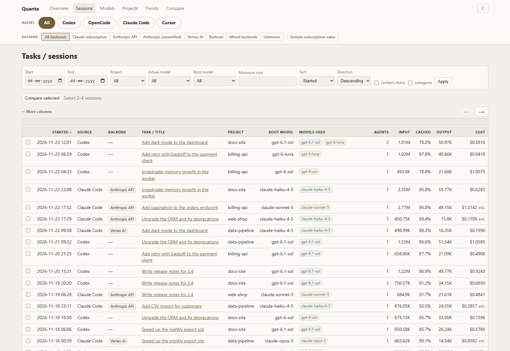
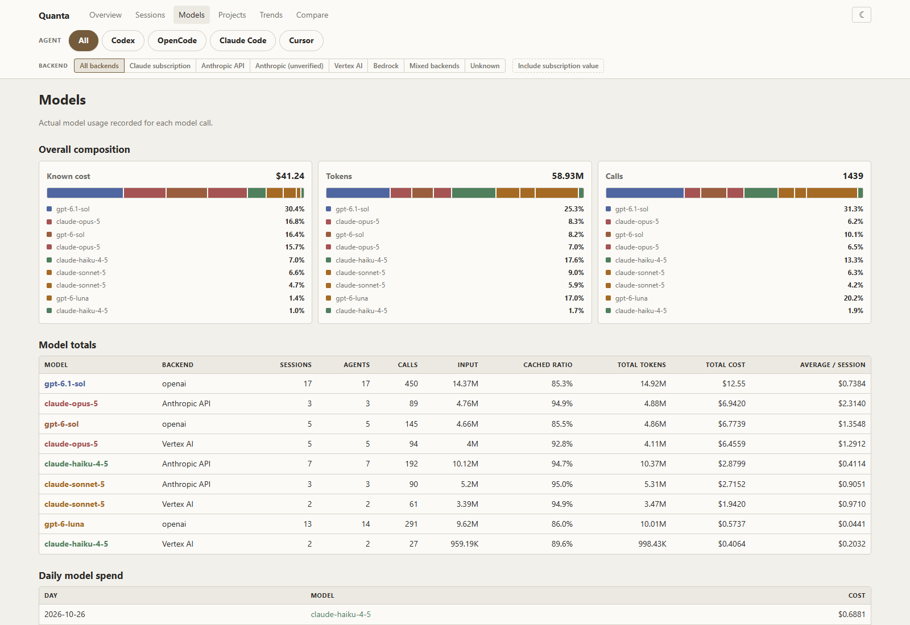

# Quanta

Local usage and cost analytics for AI coding agents.

Quanta reads the history that **Codex**, **Claude Code**, **OpenCode**, and **Cursor** already keep on your machine. It turns that history into per-session token counts and dollar costs, and shows them in a local web dashboard and a CLI. Nothing leaves your machine, except an optional price lookup for models it has no price for.



## What it does

- **One ledger for every agent.** Sessions, subagents, models, tokens, and cost from all four tools in one SQLite database.
- **Auditable costs.** Each dollar figure comes from normalized per-call usage rows and dated price rows. The formulas are in [docs/accounting.md](docs/accounting.md).
- **Subagent-aware.** Child agents roll up into their root task, so you see what a whole task cost.
- **Claude backend and billing detection.** Separates Anthropic API-key, claude.ai subscription, Vertex AI, and Bedrock usage. Subscription usage shows $0 real spend, with an optional "equivalent API value" toggle.
- **Read-only and private.** Source files and databases are opened read-only. Quanta never stores prompts, responses, tool arguments or output, code, or credentials. It keeps only metadata, token counters, costs, and a short first-message preview, which you can turn off with `--no-preview`.
- **Incremental.** Re-scans pick up only new or changed data, and deduplication keeps rescans safe.

| Overview | Sessions | Models |
|---|---|---|
|  |  |  |

## Requirements

- Python 3.11+
- [uv](https://docs.astral.sh/uv/) (recommended) or pip

## Install

```bash
uv sync                # installs runtime + dev dependencies into .venv
```

Or with pip:

```bash
python -m venv .venv
# Windows: .venv\Scripts\activate    macOS/Linux: source .venv/bin/activate
pip install -e .
```

## Quick start

```bash
uv run quanta doctor   # check which agent histories were found
uv run quanta ingest   # import them into the dashboard database
uv run quanta serve    # open http://127.0.0.1:8765
```

`serve` also re-ingests in the background every 10 seconds (`--interval`), so the dashboard stays current while you work.

## CLI reference

| Command | Purpose |
|---|---|
| `quanta doctor` | Show discovered sources, auth/billing detection, and data-quality warnings |
| `quanta ingest [--all]` | Import new or changed history (`--all` rescans whole files) |
| `quanta watch [--interval N]` | Ingest continuously |
| `quanta serve [--host H] [--port P] [--interval N]` | Run the web dashboard |
| `quanta sessions [--limit N] [--sort time\|cost\|tokens\|duration\|agents]` | List sessions in the terminal |
| `quanta export --format csv\|json [--breakdown sessions\|models] [-o FILE]` | Export accounting data |
| `quanta prices` | List the historical price table |
| `quanta prices-update` | Fetch prices for unpriced models from [models.dev](https://models.dev) |
| `quanta price-add MODEL FROM --input … --cached-input … --cache-write … --output-price … --source …` | Add a price row and reprice affected usage |
| `quanta tag SESSION_ID [TAGS…]` | Replace a session's tags |
| `quanta rebuild [--yes]` | Clear imported data and reimport (keeps tags) |

`sessions` and `export` accept `--source all|codex|opencode|claude|cursor`, `--backend …`, and `--include-subscription`.

## Configuration

Each source is auto-discovered. You can override any of them with a flag or an environment variable:

| Source | Flag | Environment variable | Default |
|---|---|---|---|
| Codex | `--codex-home` | `CODEX_HOME` | `~/.codex` |
| Claude Code | `--claude-home` | `CLAUDE_CONFIG_DIR` | `~/.claude` |
| OpenCode | `--opencode-db` | `OPENCODE_DB` | `$XDG_DATA_HOME/opencode/opencode.db` |
| Cursor agent | `--cursor-home` | `CURSOR_HOME` | `~/.cursor` |
| Cursor editor | `--cursor-user-dir` | `CURSOR_USER_DIR` | platform `Cursor/User` dir |
| Dashboard DB | `--database` | `QUANTA_DB` | `$XDG_DATA_HOME/quanta/dashboard.sqlite` (`~/.local/share/...`) |

Other settings:

- `QUANTA_CLAUDE_BILLING` (or `--claude-billing`): set to `auto`, `subscription`, or `api` to force how direct Anthropic calls are classified.
- `QUANTA_PRICE_FETCH=0` turns off network price lookups.

The dashboard database must sit outside every source directory. Quanta refuses to start if it doesn't.

## Project layout

```text
src/quanta/
  cli.py            argparse CLI entry point (`quanta`)
  config.py         Settings + source discovery
  db.py             SQLite schema (sessions, agents, usage, prices, tags, ...)
  pricing.py        built-in price table, cost computation, repricing
  price_sources.py  models.dev fallback for unpriced models
  reports.py        shared SQL for session/model reports
  ingestion/        one adapter per source (rollout/scanner = Codex, claude, cursor, opencode)
  web/              FastAPI app + Jinja templates (overview, sessions, models, projects, trends, compare)
tests/              pytest suite
docs/               accounting method and data-source details
scripts/            lint helpers and demo-data generator
```

## Development

```bash
uv run pytest          # run tests
scripts/lint.sh        # ruff + flake8
```

## Further reading

- [docs/data-sources.md](docs/data-sources.md): what Quanta reads from each agent and how
- [docs/accounting.md](docs/accounting.md): how every displayed dollar is computed

## License

Apache-2.0.
